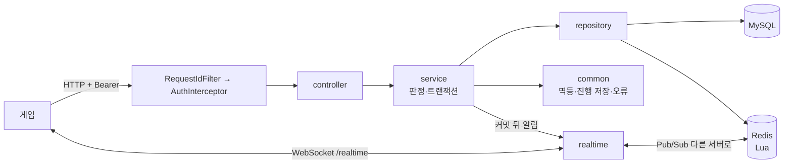

# PW01WebServer


**ProjectWarrior(UE 5.8 액션 게임)의 게임 서버입니다.** 게임이 보낸 계정·결과·성장·소셜 요청을 검증·판정하고 MySQL·Redis에 저장합니다. 보상·포인트·해금·웨이브 구성·난이도 배율의 **원본은 서버**이고, 게임은 "무엇을 했는지"만 보냅니다.

- 작업 공간 루트: [PW01](https://github.com/NBCGameServerCamp09Team01/PW01) (이 폴더는 루트 안의 `PW01\PW01WebServer\`) · 게임: [ProjectWarrior](https://github.com/NBCGameServerCamp09Team01/ProjectWarrior)
- 게임과의 약속(API·Redis 키·오류 형식): 루트 `docs/contracts/` — **코드보다 명세를 먼저 고칩니다**
- 작업 규칙: [AGENTS.md](AGENTS.md), 루트 `docs/git-workflow.md`. 이 저장소의 기준 브랜치는 **`dev`** 입니다

| 항목 | 값 |
|---|---|
| Java | 21 |
| Spring Boot | 4.1.1 (Web MVC · Data JPA · WebSocket · Actuator · Validation), Gradle 9.5.1 (Groovy DSL) |
| DB | MySQL 8.4 + Flyway (V1~V11) |
| 캐시·상태 | Redis 7.4 (Lua 스크립트 13개, Pub/Sub) |
| 테스트 | JUnit 6, Testcontainers(MySQL·Redis), MockMvc |
| 배포 | Docker 이미지 → ECR → EC2(SSM), GitHub Actions + OIDC. 웨이브 정의는 S3 |

---

## 무엇을 하나

| 기능 | API(루트 명세) | 패키지 |
|---|---|---|
| 가입·로그인·세션(하트비트·로그아웃·다른 곳 로그인) | A1~A5 `/auth/*` ([auth-api](https://github.com/NBCGameServerCamp09Team01/PW01/blob/main/docs/contracts/auth-api.md)) | `auth` |
| 계정 스냅샷(레벨·경험치·포인트·스탯·스킬·`version`) | A3 `GET /accounts/me` (account-api) | `account` |
| 스테이지 정의·내 진행, 웨이브·몬스터·난이도·수식어 정의 | ST1 `GET /stages`, ST2 `GET /accounts/me/stages` (stage-api) | `stage` |
| 판 시작(웨이브 구성·난이도 고정)·현재 판·포기·체크포인트 | P1~P5, C1·C2 `/accounts/me/stage-plays…` (stage-play-api) | `stageplay` |
| 결과 제출·보상·누적 통계 | R1·R2 `…/{stagePlayId}/result` (result-api) | `stageresult` |
| 스탯 투자 / 스킬 해금·조건 판정 | T1 `/accounts/me/stat-investments` / K1·K2 `/accounts/me/skill-unlocks`·`/skills` | `stat` / `skill`·`progression` |
| 랭킹(스테이지·지역·전체·진행, 전체·주간, 난이도별) | RK1~RK8 `/rankings/*` (ranking-api) | `ranking` |
| 길드(찾기·만들기·가입 신청·승인·거절·탈퇴·해체) | G1~G12 `/guilds`, `/accounts/me/guild…` (guild-api) | `guild` |
| 전체·길드 채팅(횟수 제한·도배 쉬기·길드 내역) | CH1~CH3 `/chats/*` (chat-api) | `chat` |
| 실시간 연결·서버 사이 전달·접속 상태 | WebSocket `/realtime` (realtime-api) | `realtime`, `presence` |

모든 기능이 같이 쓰는 뼈대(`common`): 요청 번호(`X-Request-Id`) · 인증 인터셉터(세션 10분 연장) · 공통 오류 응답(`{code, message, path, retryable, errors}`) · **같은 `requestId`는 한 번만**(`IdempotencyService`) · 진행 저장(부딪히면 다시) · 마스터 파일 검사(틀리면 기동 실패) · 서버 번호.


## 처음 받기

### 1. 준비물

- **JDK 21**: IntelliJ의 File → Project Structure → SDKs → Download JDK에서 21을 받으면 됩니다(배포판은 상관없음). IntelliJ가 기본 위치(사용자 폴더의 `.jdks`)에 받은 JDK는 터미널의 `java`가 다른 버전이어도 Gradle이 찾아 씁니다. `.\gradlew -q javaToolchains`로 확인할 수 있고, 못 찾으면 환경 변수 `JAVA_HOME`을 JDK 21 폴더로 잡습니다.
- **Docker Desktop**: 실행 중이어야 compose와 테스트가 돕니다.
- IntelliJ는 이 폴더(`PW01WebServer`)를 엽니다. 루트(`PW01`)는 IDE로 열지 않습니다.

### 2. 받기

새로 받을 때는 루트에서 `tools\setup.bat web`을 실행하거나, `PW01\` 안에서:

```bat
git clone https://github.com/NBCGameServerCamp09Team01/PW01WebServer.git
```

이미 받아 둔 경우에는 이 폴더에서:

```bat
git fetch
git switch dev
git pull --ff-only
```

git 명령은 이 폴더(`PW01\PW01WebServer\`) 안에서 실행합니다.

### 3. 로컬 MySQL·Redis 띄우기

```bat
copy .env.example .env
```

`.env`를 열어 `MYSQL_PASSWORD`, `MYSQL_ROOT_PASSWORD`, `REDIS_PASSWORD` 값을 채운 뒤(`.env`는 커밋되지 않습니다):

```bat
docker compose up -d
docker compose ps
```

- MySQL은 `127.0.0.1:3306`, Redis는 `127.0.0.1:6379`입니다.
- 3306을 이미 다른 MySQL(예: Windows의 MySQL80 서비스)이 쓰고 있으면 `.env`에 `MYSQL_PORT=3307`처럼 다른 포트를 적습니다([트러블슈팅](docs/troubleshooting/README.md)).
- 멈추기는 `docker compose down`, 데이터까지 지우기는 `docker compose down -v`입니다.

### 4. 앱 실행 (IntelliJ)

`Pw01WebserverApplication` 실행 구성(Run → Edit Configurations)의 Environment variables에 `.env`와 같은 이름·값을 넣습니다.

- `MYSQL_PASSWORD=…;REDIS_PASSWORD=…`
- `.env`에서 포트를 바꿨다면 `MYSQL_PORT=3307`도 넣습니다. 빠지면 3306으로 붙어, PC에 따로 설치된 MySQL에서 `Access denied for user 'pw01'@'localhost'`가 납니다([트러블슈팅](docs/troubleshooting/README.md)).
- 프로필은 정하지 않아도 `local`로 뜹니다(`spring.profiles.default=local`).

확인:

- http://localhost:8080/actuator/health → `"status":"UP"`, `components`에 `db`·`redis`도 각각 `UP`
- Swagger UI(확인용): http://localhost:8080/swagger-ui/index.html

운영 확인(local은 8080, `prod`는 관리 포트 8081에서만):

- 상태·버전: `/actuator/health`(DB·Redis 하위 상태), `/actuator/info`(버전·커밋), `/actuator/metrics`, `/actuator/loggers`
- 저장소가 막혔을 때: `docker compose stop redis` → health `DOWN` → API가 503. 응답 헤더 `X-Request-Id` 값으로 콘솔 로그를 찾으면 `저장소에 닿지 못함` 줄이 나온다. 끝나면 `docker compose start redis`
- 로그 수준 바꾸기: `POST /actuator/loggers/com.pw01.webserver`에 `{"configuredLevel":"DEBUG"}`, 되돌릴 때 `{"configuredLevel":null}`

### 5. 빌드·테스트

```bat
.\gradlew build
```

cmd와 PowerShell(IntelliJ 터미널 기본) 모두 `.\gradlew`로 실행합니다. 테스트가 MySQL·Redis 컨테이너를 잠깐 띄우므로 Docker Desktop이 켜져 있어야 합니다. PR을 올리면 GitHub Actions(CI)가 같은 빌드를 돌립니다.

### 6. 이미지 (선택 — 배포용 컨테이너를 로컬에서 볼 때만)

평소 개발에는 필요 없습니다. `dev`에 병합되면 GitHub Actions(`build-push-ecr.yml`)가 이미지를 만들어 AWS ECR `pw01/webserver`에 올립니다(태그 `dev-<커밋 해시>`, 배포는 하지 않음).

```bat
docker build -t pw01/webserver:local --build-arg APP_COMMIT=<커밋 해시> .
docker run --rm --network pw01-local_default --env-file .env.docker -p 8080:8080 -p 8081:8081 pw01/webserver:local
```

- 3번의 compose(MySQL·Redis)가 떠 있어야 합니다. `--network`는 compose 네트워크 이름입니다(`docker network ls`).
- `.env.docker`는 견본에서 만듭니다: `copy .env.docker.example .env.docker` → `DB_PASSWORD`·`REDIS_PASSWORD`에 `.env`와 같은 값(`MYSQL_PASSWORD`·`REDIS_PASSWORD`)을 넣습니다. `.env.docker`는 커밋되지 않습니다.
- 실행 중인 IntelliJ 앱과 8080이 겹치면 먼저 멈춥니다.

### 7. 로컬 로드 밸런서 환경 (선택 — 서버 두 대 동작을 볼 때)

배포는 로드 밸런서 뒤에 서버가 여러 대입니다. 실시간 메시지가 다른 서버에 붙은 사람에게도 가는지(서버 사이 전달, 루트 `docs/flows/realtime-relay.md`) 보려면 PC에서 같은 모양을 띄웁니다. `compose.yaml`은 그대로 두고 `compose.apps.yaml`을 겹쳐 씁니다.

```bat
docker compose -f compose.yaml -f compose.apps.yaml up -d --build
docker compose -f compose.yaml -f compose.apps.yaml ps
curl.exe -si http://localhost:8080/health
```

| 주소 | 무엇 |
|---|---|
| `http://localhost:8080` | 로드 밸런서(nginx, 라운드 로빈·WebSocket·유휴 120초). 게임 PIE 기본 주소 그대로 |
| `http://localhost:8081` | app-a 바로(서버를 고를 때) |
| `http://localhost:8082` | app-b 바로 |

- 응답 헤더 `X-Upstream`이 두 앱을 번갈아 가리키면 정상입니다(로컬 nginx만 붙이는 헤더).
- 앱은 `local` 프로필로 뜨고 `.env`의 `MYSQL_PASSWORD`·`REDIS_PASSWORD`를 씁니다(따로 만들 파일 없음). 상태 확인은 `/health`, `/actuator/health` 모두 앱 포트입니다.
- 로그: `docker compose -f compose.yaml -f compose.apps.yaml logs -f app-a app-b`. 요청 하나는 `… logs app-a app-b | findstr <requestId>`. 뜰 때 찍히는 `[Relay] serverId=…`로 어느 앱인지 압니다.
- 서버를 정해 붙기: 게임 Standalone 실행 인자 `-ServerUrl=http://localhost:8082`, Postman WebSocket `ws://localhost:8082/realtime`(헤더 `Authorization: Bearer <토큰>`).
- 앱 하나 멈춤 시험: `… stop app-b` → 요청이 모두 app-a로 → `… start app-b` → 뜬 뒤 10초쯤 지나면 다시 번갈아 갑니다(nginx가 실패한 앱을 잠깐 빼 두었다가 다시 시도). nginx를 다시 띄울 때는 두 앱이 떠 있어야 합니다.
- 코드를 고쳤으면 첫 줄을 다시(`--build`). 끝낼 때는 `… stop`(`down -v`는 데이터를 지웁니다).
- 4번의 IntelliJ 앱과 8080이 겹치므로 먼저 멈춥니다. PC 메모리 약 2.5~3GB를 씁니다.

**웨이브 정의를 재시작 없이 바꿔 보기(파일 출처, 선택)** — 배포 서버는 웨이브 구성(`stage-waves.json`)을 S3에서 읽고 재시작 없이 바꿉니다(루트 `docs/contracts/stage-api.md` "웨이브 구성 바꾸기"). 로컬에서는 S3 대신 PC의 파일 하나를 두 앱이 함께 보게 해서 같은 흐름(다시 읽기 신호 → 다른 앱에 알림 → 교체, 검사 실패면 유지, 5분 안전망)을 AWS 없이 해 봅니다. 기본은 지금처럼 이미지 안 리소스(classpath)라 켜지 않으면 아무것도 달라지지 않습니다.

```bat
:: 처음 한 번: 리소스 파일을 복사(local/content 는 git이 무시)
mkdir local\content
copy src\main\resources\master\stage-waves.json local\content\
:: 파일 출처로 띄우기(PowerShell은 $env:STAGE_CONTENT_SOURCE="file" 다음 줄에 compose 명령). 안전망을 짧게 보려면 STAGE_CONTENT_SAFETY_POLL=20s
set STAGE_CONTENT_SOURCE=file
docker compose -f compose.yaml -f compose.apps.yaml up -d --build
curl.exe -s http://localhost:8081/actuator/stagecontent
```

- 처음 띄울 때 Docker Desktop이 `local\content` 폴더 공유를 물으면 허용합니다(거절하면 `user declined directory sharing`으로 앱이 만들어지지 않음).
- 바꾸기: `local\content\stage-waves.json`을 고치고 `"version"`을 쓴 적 없는 숫자로 올려 저장 → `curl.exe -s -X POST http://localhost:8081/actuator/stagecontent` → `"result":"CHANGED"`. 몇 초 안에 `curl.exe -s http://localhost:8082/actuator/stagecontent`의 `waveVersion`도 같아집니다(app-b 로그 `[Relay] content changed`, `[Content] 정의 교체 … reason=relay`).
- 거절: version을 그대로 두고 내용만 바꾸면 `"result":"REJECTED"`, 두 앱 모두 이전 정의를 씁니다. 되돌리기는 파일을 원래대로 저장하고 다시 POST.
- 안전망: POST 없이 저장만 해 두면 안전망 주기(기본 5분) 안에 두 앱이 따라옵니다(`reason=poll`).
- 원래대로: `set STAGE_CONTENT_SOURCE=` 로 지우고 같은 `up -d` 명령을 다시 하면 classpath로 돌아갑니다.
- IntelliJ 앱 하나로 해 보려면 실행 구성 환경 변수에 `PW01_STAGECONTENT_SOURCE=file`, `PW01_STAGECONTENT_FILE_PATH=local/content/stage-waves.json`(Spring 환경 변수 이름은 대시가 빠짐).

## 구조

기능마다 `controller → service → repository` 세 층이고(`entity`·`dto`는 기능 안), 다른 기능의 데이터는 그 기능의 Service로만 가져옵니다([AGENTS.md](AGENTS.md) "코드").

```
src/main/java/com/pw01/webserver/
├─ auth/ · account/                    ← 인증·세션, 계정 스냅샷·레벨 곡선·변경 내역
├─ stage/ · stageplay/ · stageresult/  ← 스테이지 정의(웨이브 정의 다시 읽기 포함), 판, 결과
├─ stat/ · skill/ · progression/       ← 스탯 투자, 스킬 해금, 해금 조건 판정
├─ ranking/ · guild/ · chat/           ← 랭킹, 길드, 채팅
├─ realtime/ · presence/               ← WebSocket·서버 사이 전달, 접속 상태
├─ common/                             ← 오류·멱등·로그·마스터 파일·서버 번호·채팅↔길드 약속
└─ config/                             ← 기능별 설정 값(…Properties)과 빈
src/main/resources/
├─ application*.properties             ← 공통 · local · prod (test는 src/test/resources)
├─ db/migration/                       ← Flyway V1~V11
├─ master/                             ← 레벨 곡선·스테이지·스탯·스킬·웨이브·몬스터·난이도(JSON 7개)
└─ redis/                              ← Lua 스크립트(세션·로그인 실패·체크포인트·랭킹·접속·채팅)
```

- 프로필·환경 변수·요청 흐름: [docs/overview.md](docs/overview.md), 세팅 명세: [docs/initial-setup.md](docs/initial-setup.md)
- 테이블: [docs/migrations.md](docs/migrations.md), ERD [docs/erd/](docs/erd/)(스테이지·길드·채팅)
- 결정 기록: [docs/decisions/](docs/decisions/)(초기 설정, 랭킹 저장 방식 — 실행 계획 비교, 길드 동시성), 겪은 문제: [docs/troubleshooting/](docs/troubleshooting/README.md)

## API

- 명세 원본은 루트 `docs/contracts/`입니다. 공통 규칙(경로는 기능 이름부터·버전 없음, 시각 UTC, 오류 응답, 재전송, 모르는 필드는 400)은 그 폴더의 README.md에 있습니다.
- Swagger UI는 실행 중인 서버를 확인하는 보기입니다(http://localhost:8080/swagger-ui/index.html). 명세와 다르면 명세가 기준입니다.

## 검증

| 항목 | 값 | 측정 |
|---|---|---|
| 자동 시험 | `.\gradlew build` 465개 통과, 실패 0 | 2026-10-16 (#33 병합 뒤) |
| 동시성 예 | 같은 계정 동시 채팅 10번 → 정확히 5번 통과(Lua 한 번 판단) | `RedisChatRateLimiterTest` |
| 랭킹 조회 | 계정 1만·클리어 5만에서 실행 계획 비교 | [docs/decisions/0002-랭킹-저장-방식.md](docs/decisions/0002-랭킹-저장-방식.md) |
| 길드 동시성 | 정원·중복 가입 경합 시험 | [docs/decisions/0003-guild-concurrency.md](docs/decisions/0003-guild-concurrency.md) |
