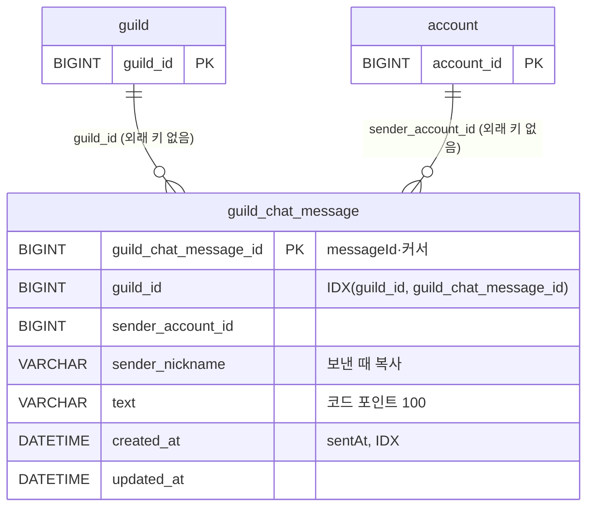

# ERD: 채팅(M23)

> 마이그레이션 `V11__create_guild_chat_message.sql` · 명세 루트 `docs/contracts/chat-api.md`(길드 채팅 내역이 이 표를 읽음) · 코드 `chat` 패키지(`GuildChatHistoryImpl`이 두 모듈 약속 `common/chat/GuildChatHistory`를 구현)

전체 채팅은 저장하지 않습니다(`NoStoreGlobalChatHistory`). 길드 채팅만 이 표에 둡니다.

## guild_chat_message

길드 채팅 한 줄입니다. 저장한 뒤 바꾸지 않습니다.

| 칼럼 | 타입 | 설명 |
|---|---|---|
| `guild_chat_message_id` | BIGINT, 자동 증가 | 메시지 번호. 응답의 `messageId`와 내역 커서(`before`·`nextCursor`)에 10진수 문자열로 나갑니다. 길드 안 순서 = 번호 순 |
| `guild_id` | BIGINT | `guild.guild_id`. **외래 키 없음** — 길드가 해체되면 채팅이 `GuildDisbandedEvent`를 받아 그 길드 줄을 지웁니다(길드는 이 표를 모릅니다) |
| `sender_account_id` | BIGINT | 보낸 `account.account_id`. 외래 키 없음 |
| `sender_nickname` | VARCHAR(20) | 보낸 때의 닉네임을 복사합니다(닉네임이 바뀌어도 그 줄은 그대로) |
| `text` | VARCHAR(100) | 채팅 글. 코드 포인트 100자(`pw01.chat.max-length`, 이모지 하나가 1자) |
| `created_at` | DATETIME(3), UTC | 서버가 받은 시각 = `sentAt`(밀리초까지) |
| `updated_at` | DATETIME(3), UTC | 수정 시각(바꾸지 않으므로 `created_at`과 같음) |

| 인덱스 | 쓰는 곳 |
|---|---|
| `idx_guild_chat_message_guild (guild_id, guild_chat_message_id)` | 내역: 그 길드에서 번호가 `before`보다 작은 줄을 최신부터 |
| `idx_guild_chat_message_created (created_at)` | 보관 기간(3일, `pw01.chat.guild.retention`)이 지난 줄 지우기 |

- 내역은 늘 `created_at ≥ 지금 − 3일`로 거릅니다. 지우기 작업이 아직 돌지 않았어도 오래된 줄은 보이지 않습니다.
- 외래 키를 걸지 않은 이유: 걸면 해체가 채팅 줄을 먼저 지워야 해서 길드가 채팅에 묶입니다(길드 설계 G-29 a, 채팅 계획서 C-12).
