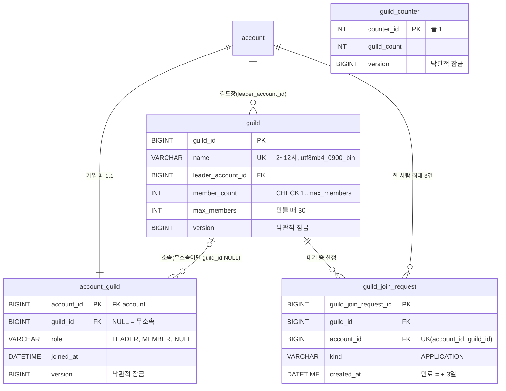

# ERD: 길드

> 마이그레이션 `V10__create_guild.sql` · 명세 루트 `docs/contracts/guild-api.md` v1.1(G1~G12) · 동시성 결정 [decisions/0003-guild-concurrency.md](../decisions/0003-guild-concurrency.md) · 코드 `guild` 패키지(`presence`는 Redis만 씀)

- 엔티티끼리 `@ManyToOne`을 걸지 않고 ID 값(`Long`)만 가집니다(`AccountStageProgress`와 같은 방식).
- 외래 키에는 참조 동작(`ON DELETE`·`ON UPDATE`)을 두지 않습니다. MySQL은 참조 동작에 쓰인 칼럼을 CHECK에 쓰지 못하고(`account_guild.guild_id`), 해체는 서비스가 소속을 먼저 비우고 신청을 지운 뒤 길드를 지웁니다.
- 길드 채팅 표(V11, 채팅 담당)는 `guild`에 외래 키를 걸지 않습니다. 채팅이 해체 이벤트(`GuildDisbandedEvent`)를 받아 자기 행을 지웁니다.

## guild

길드마다 한 행입니다. 해체하면 행을 지웁니다.

| 칼럼 | 타입 | 설명 |
|---|---|---|
| `guild_id` | BIGINT, 자동 증가 | 길드 ID. API에서는 숫자 문자열 |
| `name` | VARCHAR(12), `utf8mb4_0900_bin` | 길드 이름. **대소문자를 가림**(`Dawn` ≠ `dawn`), 유일 |
| `leader_account_id` | BIGINT | 길드장 `account.account_id`. 길드장 넘기기는 없음 |
| `member_count` | INT | 길드원 수(길드장 포함). `account_guild`의 실제 수와 같은 트랜잭션에서 고침 |
| `max_members` | INT | 정원. 만들 때 설정 값(`pw01.guild.max-members`, 30)을 적음 |
| `version` | BIGINT | 낙관적 잠금 번호(`@Version`). 인원이 바뀔 때마다 오름 |
| `created_at`·`updated_at` | DATETIME(3), UTC | 생성·수정 시각. G1 목록은 `guild_id` 내림차순(= 최근 만든 순) |

| 제약 | 내용 |
|---|---|
| `uk_guild_name` | 이름 유일(칼럼 정렬 규칙이 bin이라 대소문자 가림) |
| `fk_guild_leader_account` | 있는 계정만 |
| `ck_guild_name` | `^[가-힣A-Za-z0-9][가-힣A-Za-z0-9 ]{0,10}[가-힣A-Za-z0-9]$`(대소문자 가림 `'c'`) + `NOT LIKE '%  %'`(정규식만으로는 연속 공백을 못 막음) |
| `ck_guild_max_members` | 정원 1 이상 |
| `ck_guild_member_count` | `member_count BETWEEN 1 AND max_members`. 정원 초과의 마지막 방어. 0명이 되는 길은 행 삭제(해체)뿐 |

## account_guild

계정마다 한 행입니다(기본 키 = 계정). **행이 있고 `guild_id`가 NULL이면 무소속**입니다. 한 사람 한 길드를 기본 키 하나로 지키고, 동시성 제어 때 잠글 행이 늘 있게 하려고 무소속도 행으로 둡니다.

| 칼럼 | 타입 | 설명 |
|---|---|---|
| `account_id` | BIGINT | `account.account_id`와 같은 값(1:1) |
| `guild_id` | BIGINT, NULL 가능 | 소속 길드. NULL = 무소속 |
| `role` | VARCHAR(10), NULL 가능 | `LEADER` · `MEMBER`. 무소속이면 NULL |
| `joined_at` | DATETIME(3), NULL 가능, UTC | 들어온 시각. 무소속이면 NULL. G4 길드원 순서(길드장 먼저, 그다음 이 값 순) |
| `version` | BIGINT | 낙관적 잠금 번호. 신청 때는 `PESSIMISTIC_FORCE_INCREMENT`로 먼저 올려 같은 사람의 동시 신청을 하나씩 처리 |
| `created_at`·`updated_at` | DATETIME(3), UTC | 생성·수정 시각 |

| 제약·인덱스 | 내용 |
|---|---|
| PK `account_id` | 한 사람 한 행 = 한 사람 한 길드 |
| `fk_account_guild_account`, `fk_account_guild_guild` | 있는 계정·길드만. 길드원이 남은 `guild` 행은 지울 수 없음 |
| `ck_account_guild_role` | `LEADER`·`MEMBER`만 |
| `ck_account_guild_membership` | `guild_id`·`role`·`joined_at` 셋 다 NULL(무소속)이거나 셋 다 값 |
| `idx_account_guild_guild_joined (guild_id, joined_at)` | 길드원 목록(G4, `GuildDirectory.memberIds`) 범위 읽기 |

행을 만드는 때:

| 때 | 어떻게 |
|---|---|
| V10 실행 | 기존 계정마다 무소속 행 |
| 새 가입 | 가입 이벤트(`AccountCreatedEvent`)를 같은 트랜잭션에서 받아 저장(`AccountGuildInitializer`). 실패하면 가입도 롤백 |
| 행이 없는 계정(옛 서버가 받은 가입 등) | 길드 쓰기가 그 자리에서 만듦(`insertIfAbsent` = `INSERT … ON DUPLICATE KEY UPDATE`). 읽기(G4)는 만들지 않고 무소속으로 봄 |

## guild_join_request

대기 중인 가입 신청입니다. 수락·거절·취소·해체되면 **지웁니다**(이력을 남기지 않음).

| 칼럼 | 타입 | 설명 |
|---|---|---|
| `guild_join_request_id` | BIGINT, 자동 증가 | 신청 ID. API에서는 숫자 문자열 |
| `guild_id` | BIGINT | 신청한 길드 |
| `account_id` | BIGINT | 신청한 사람 |
| `kind` | VARCHAR(20) | `APPLICATION`(신청). 초대를 넣을 때 CHECK에 `INVITATION`을 더하는 마이그레이션 하나 |
| `created_at`·`updated_at` | DATETIME(3), UTC | `created_at` = 신청 시각 = 유효 기간의 시작 |

| 제약·인덱스 | 내용 |
|---|---|
| `uk_guild_join_request_account_guild (account_id, guild_id)` | 같은 길드와 대기 중인 관계는 하나(신청·초대 함께) |
| `idx_guild_join_request_guild (guild_id, guild_join_request_id)` | 받은 신청(G7) 오래된 순 |
| `fk_guild_join_request_guild` | 해체된 길드에 신청이 들어가지 않음(그사이 해체되면 INSERT가 여기에 걸려 404 `GUILD_NOT_FOUND`) |
| `fk_guild_join_request_account` | 있는 계정만 |
| `ck_guild_join_request_kind` | 지금은 `APPLICATION`만 |

- **유효 기간 칼럼이 없습니다.** `created_at + pw01.guild.join-request-ttl`(3일)로 읽을 때 거릅니다. 설정을 바꾸면 이미 들어온 신청에도 바로 적용됩니다. 만료된 행은 같은 길드에 다시 신청할 때 지우고 새로 넣습니다.

## guild_counter

서버 길드 수입니다. 행은 하나(`counter_id = 1`)이고 V10이 `(1, 0)`으로 넣습니다.

| 칼럼 | 타입 | 설명 |
|---|---|---|
| `counter_id` | INT | 늘 1 |
| `guild_count` | INT | 지금 길드 수. 만들기 +1, 해체 −1 |
| `version` | BIGINT | 낙관적 잠금 번호. 동시 만들기를 하나씩 통과시킴 |
| `created_at`·`updated_at` | DATETIME(3), UTC | 생성·수정 시각 |

| 제약 | 내용 |
|---|---|
| `ck_guild_counter_single` | `counter_id = 1`(행 하나) |
| `ck_guild_counter_count` | 0 이상 |

- 상한(기본 5, `pw01.guild.max-guilds`)은 설정 값이라 CHECK로 두지 않고 서비스가 판정합니다. `COUNT(*)` 대신 이 표를 두는 이유는 "세고 나서 만들기" 사이에 다른 만들기가 끼는 것을 한 행의 `version`으로 막기 위해서입니다([0003](../decisions/0003-guild-concurrency.md) D05).

## Redis

길드의 원본은 위 MySQL 표입니다. Redis에는 한 번만 반영 키(`pw01:idem:…`)와 접속 상태 키(`pw01:presence:<계정>`)만 두고, 길드원 목록은 캐시하지 않습니다(루트 `docs/contracts/redis-keys.md` "접속 상태"·"길드").
